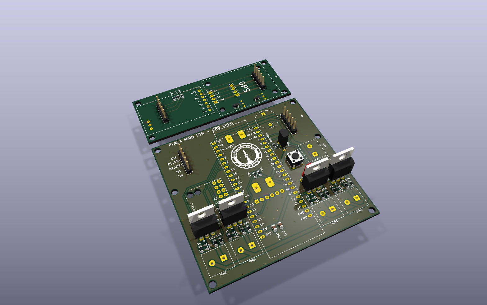
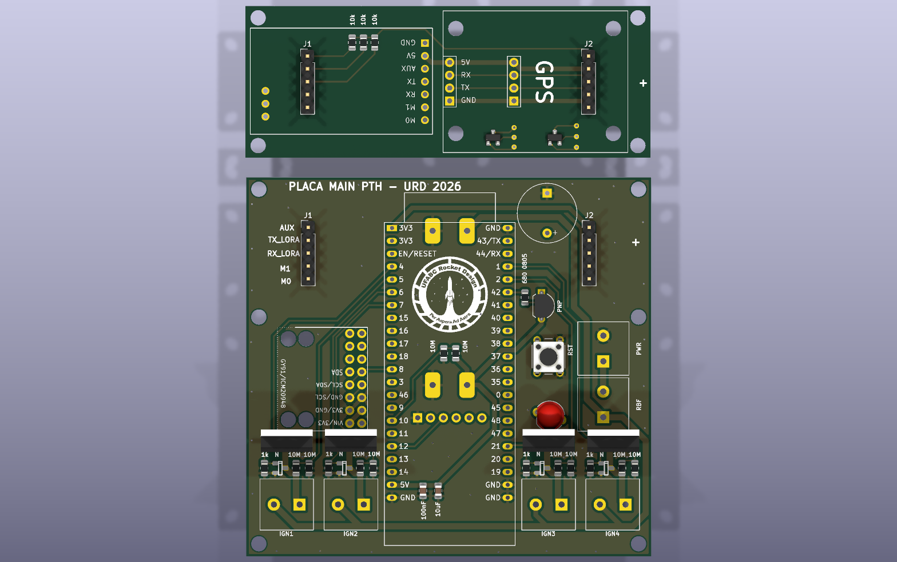
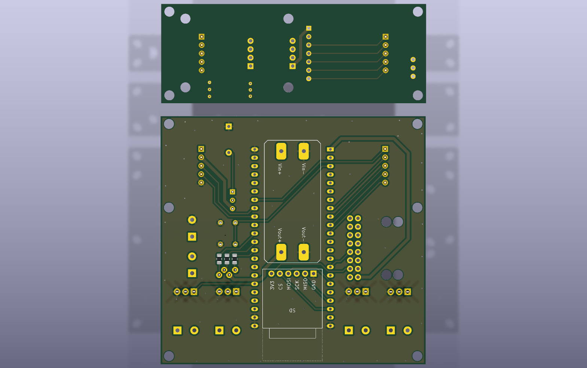

# Essentials V2

Segunda versão da placa Essentials, redesenhada para o **ESP32-S3**. Ela é composta por **dois módulos**: a placa principal e uma placa de comunicação separada para o **LoRa e o GPS**, que pode ser posicionada em outro lugar do foguete, longe de interferências.

## Destaques

- **ESP32-S3-DevKitC** como microcontrolador
- **4 canais de ignição** (IGN1–IGN4) para eventos de recuperação, com MOSFETs de potência IRLZ44N e drivers SI2300
- Módulo de comunicação com rádio LoRa **E32-915T20D** e conector para GPS
- Conector para IMU (GY-91 / ICM-20948), LED RGB de status, botão de reset e pontos de teste
- Firmware: [FlightCode](https://github.com/jcardozo08/FlightCode) / [FlightComputerRTOS](https://github.com/jcardozo08/FlightComputerRTOS)

| Topo | Base |
|:---:|:---:|
|  |  |

## Arquivos

- `Essentials V2.kicad_sch`: esquemático ([ver em SVG](images/schematic.svg))
- `Essentials V2.kicad_pcb`: layout das duas placas ([ver em SVG](images/layout.svg))
- `Essentials V2.step`: modelo 3D

**Ferramenta:** KiCad
